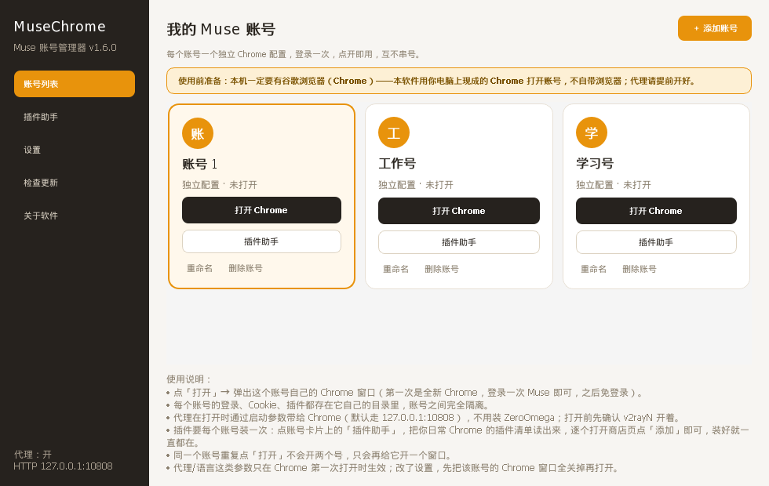
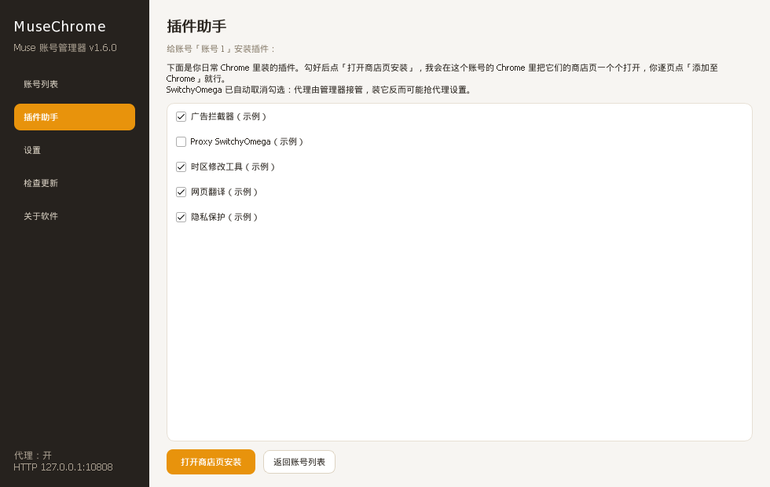
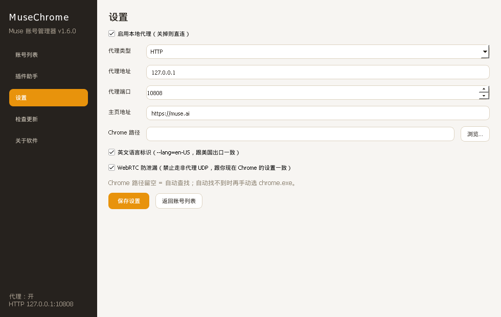
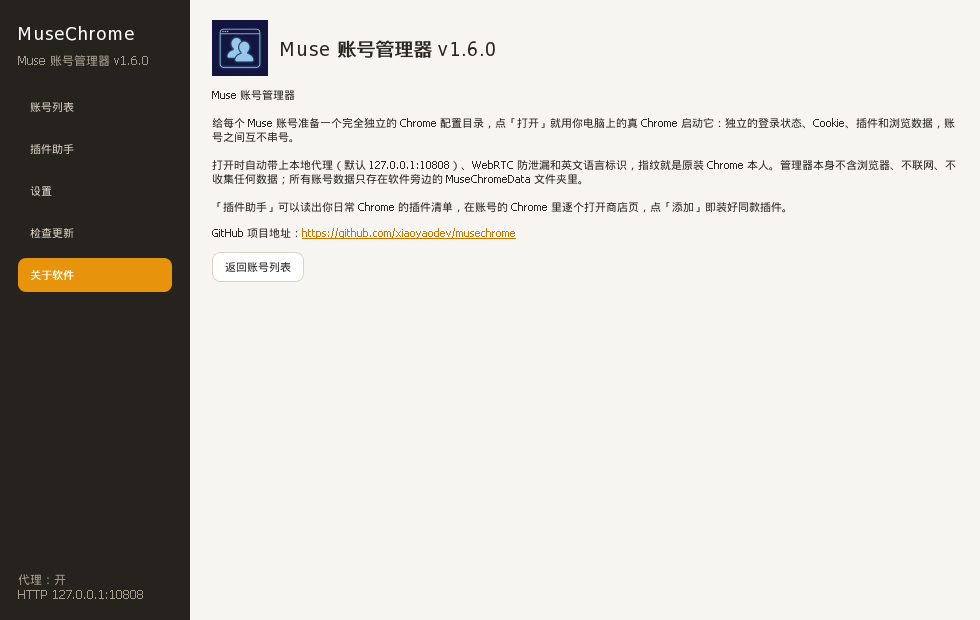

# MuseChrome · Muse 账号管理器

给每个 Muse 账号准备一个**完全独立的 Chrome 配置目录**，点一下就用你电脑上的真 Chrome 打开它：独立的登录状态、Cookie、插件和浏览数据，账号之间互不串号。管理器本身不含浏览器、不联网、不收集数据。

适合需要 **Muse 多账号切换、多账号同时登录、防串号** 的人：自媒体运营、多平台账号管理、团队协作等场景，一个账号一套独立浏览器环境，登录一次，点开即用。


## 下载

到 [Releases](../../releases) 下载便携版 `MuseChrome-v1.6.1.exe`，双击即可运行（免安装，未签名，首次运行如遇 SmartScreen 提示，点「更多信息 → 仍要运行」）。想要安装版（双击安装、可选安装目录、自动建桌面快捷方式和开始菜单项、带卸载）的，去 Releases 里的 `setup-v1.6.1` 下载 `MuseChrome-Setup-v1.6.1.exe`。v1.5.0 起，之后的新版可以在软件里点「检查更新」直接下载、自动替换并重启，不用再来网页下载。

**使用前准备：本机一定要有谷歌浏览器（Chrome）**——本软件用你电脑上现成的 Chrome 打开账号，不自带浏览器；代理请提前开好。

数据保存在 exe 旁边的 `MuseChromeData/` 文件夹里，删掉 exe 不影响数据，搬走整个文件夹即可迁移。

## 功能

- **多账号隔离**：每个账号一个独立的 Chrome 配置目录（`MuseChromeData/chrome-profiles/`），登录一次后免登录，重复点「打开」只多开一个窗口、不会串号。
- **本地代理**：打开 Chrome 时通过启动参数带上本地代理（默认 HTTP `127.0.0.1:10808`，可在设置里改类型/地址/端口或关闭），不用装代理插件；使用前先开好你自己的代理工具。
- **防泄漏**：启动时带上 WebRTC 防泄漏参数（禁止走非代理 UDP）和英文语言标识（`--lang=en-US`），均可在设置里开关。
- **插件助手**：读出你日常 Chrome 已装的插件清单，在账号的 Chrome 里逐个打开它们的商店页，点「添加」即装好同款插件（装一次永久保留）。代理类插件（如 SwitchyOmega）默认不勾选——代理已由管理器接管，避免冲突。
- **设置**：代理类型/地址/端口、主页地址、Chrome 路径（自动查找，找不到可手动指定）。
- **检查更新 / 软件内更新**：左侧边栏一键检查 GitHub 最新版本（走软件里配置的本地代理）；有新版点「立即更新」直接在软件里下载（带进度，下载后校验文件大小与 SHA256），下载完自动关闭、替换成新版并重新打开，全程不用去网页。

## 截图

主界面（左侧边栏导航 + 账号卡片，橙色提示条标注使用前准备）：



插件助手（已改成主区页面；读出日常 Chrome 的插件，逐个打开商店页安装；截图中为演示数据，不是任何人的真实清单）：



设置（同样是主区页面，边栏点哪个亮哪个，只亮当前页）：



关于软件：



## 使用要点

- 本机一定要有谷歌浏览器（Chrome），软件不自带浏览器，用的是你电脑上现成的 Chrome。
- 每个账号第一次打开是全新 Chrome，登录一次 Muse 即可。
- 改了代理/语言等启动参数后，要把该账号的 Chrome 窗口全部关掉再重新打开才生效。
- 插件的个人设置不会从日常 Chrome 带过来，新装后按需在各账号里设置一次。

## 从源码构建

需要 Python 3.11 + PyQt6 + PyInstaller（Windows）：

```bat
pip install PyQt6 PyInstaller
pyinstaller MuseChrome.spec
```

产物在 `dist/MuseChrome.exe`。

## 目录结构

```
main.py            入口
musechrome/        主程序（app.py 界面、store.py 配置与启动逻辑）
tests/             纯逻辑测试（python tests/test_store.py）
assets/            图标
MuseChrome.spec    PyInstaller 打包配置
```

## 更新记录

**v1.6.1**
- 新增安装版：双击安装、可选安装目录、自动创建桌面快捷方式和开始菜单项，带卸载程序（卸载不删账号数据）；程序文件名固定为 MuseChrome.exe，软件内更新原地覆盖，快捷方式不受影响。
- 修复：账号卡片「已打开」状态改为实时跟踪 Chrome 进程——关掉浏览器后几秒内自动变回「未打开」，不再一直显示已打开。
- 修复：便携版软件内更新后文件名不变的问题（新版以新文件名落地、自动删旧文件）；更新后首次启动加了延时，避开杀毒扫描高峰导致的 DLL 加载失败。
- 修正：设置页「WebRTC 防泄漏」「英文语言标识」两处说明文字改成准确的功能描述，不再预设使用者的其他软件设置。

**v1.6.0**
- 改版：设置、插件助手、关于软件从独立弹窗改成主区里的页面，点边栏直接切换；边栏同一时刻只亮当前页一个按钮。
- 修复：打开设置等弹窗时边栏出现两个按钮同时亮橙的问题（就是上条改版的原因）。

**v1.5.0**
- 新功能：软件内更新——点「检查更新」发现新版后可直接在软件里下载，校验通过后自动替换并重启，不用再去网页下载。
- 修复：插件助手名单在 Windows 深色模式下文字变白、看不见插件名的问题（名单文字颜色写死并强制浅色显示）。
- 修复：左侧边栏按钮点击没有反馈的问题（已加按下变色，打开对话框期间对应按钮保持高亮）。

**v1.4.0**
- 新界面：左侧深色边栏导航 + 账号卡片网格；主区顶部提示条标注「本机一定要有谷歌浏览器（Chrome）」。

## English

MuseChrome is a free, open-source Windows desktop app for managing multiple Muse accounts. Each Muse account gets its own isolated Google Chrome profile — separate cookies, logins, extensions and browsing data — launched with your real Chrome: no account mixing, no repeated sign-ins.

Features: per-account Chrome profiles, local proxy support (default 127.0.0.1:10808, changeable or off), WebRTC leak protection, an extension helper that re-installs your everyday Chrome extensions into each account profile, and built-in in-app updates (download in the app, auto-replace and restart). A Muse multi-account manager and account switcher for creators and teams who run several Muse accounts side by side.

## Code signing policy

Free code signing provided by SignPath.io, certificate by SignPath Foundation.

- 团队角色（Team roles）：Author / Reviewer / Approver 均为项目维护者 [xiaoyaodev](https://github.com/xiaoyaodev)（单人维护项目，源码提交、审查与每次发布的签名批准都由其本人完成）。
- 隐私（Privacy）：This program will not transfer any information to other networked systems unless specifically requested by the user or the person installing or operating it.（本程序仅在使用者主动点击「检查更新」时连接 GitHub 检查新版本；不收集、不上传任何账号数据。账号数据只保存在本机 MuseChromeData 文件夹。程序启动的 Chrome 是使用者本机安装的浏览器，其隐私政策见 Google Chrome 的相关说明。）
- 发布文件均由本仓库公开源码构建，只从本仓库 Releases 页面下载。

## 许可

MIT License，见 [LICENSE](LICENSE)。
